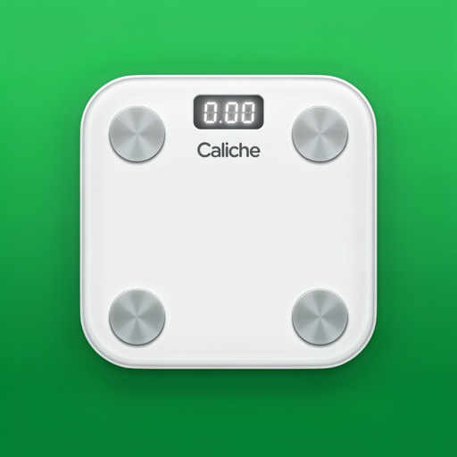

<p align="center">
  
</p>

# Caliche Balance

Web app para iPhone que toma las mediciones de tu báscula Xiaomi Mi Body Composition Scale 2 (vía Zepp Life) y las compara con rangos de referencia de Norteamérica (México, EE. UU. y Canadá), en lugar de los rangos asiáticos que usa Zepp Life.

Cada persona tiene su propia cuenta (nombre de usuario y contraseña) y sus datos se sincronizan entre dispositivos.

## Qué hace

- **Inicio:** tu última medición con peso, IMC, % de grasa y metabolismo basal. Cada valor se clasifica (Bien / Atención / Alto riesgo, siempre con ícono y texto) y muestra de dónde sale cada rango.
- **Comparación asiática:** junto al IMC te dice cómo te clasificaría un rango asiático como el de Zepp Life, para que veas la diferencia.
- **Historial:** todas las gráficas en una sola página, con banda saludable y línea de meta donde aplica, y la lista de mediciones. Cada gráfica explica qué es la medida, qué significa tu valor más reciente (por ejemplo, tu peso saludable para tu estatura y cuánto te falta) y cuánto cambió en el periodo elegido. La grasa visceral de Xiaomi solo aparece con la comparación prendida.
- **Caliche Balance vs Xiaomi:** con el interruptor "Comparar con Xiaomi", las gráficas de grasa, masa libre de grasa, agua, metabolismo, masa magra, proteína y edad muestran las dos líneas (verde continua y azul punteada) y el tooltip da la diferencia. En Inicio, una tabla compara tu última pesada completa. Solo se comparan medidas que significan lo mismo: el "músculo" de Xiaomi no es músculo esquelético; se compara con la masa magra sin minerales, que es lo que sí mide.
- **Agregar a mano:** como respaldo, acepta coma decimal ("74,5").
- **Báscula Xiaomi vía Zepp Life:** trae todas tus pesadas con todos sus valores (grasa, músculo, agua, masa ósea, grasa visceral, proteína, metabolismo basal, edad corporal, puntuación, peso ideal e impedancia) y se sincroniza sola.
- **Una báscula para toda la casa:** cada persona tiene su cuenta y recibe solo sus pesadas, con invitaciones y reasignación de pesadas.
- **Puntuación Caliche (0 a 100)** al inicio, propia y transparente: combina % de grasa (50 %), IMC (30 %) e índice de músculo (20 %) con rangos publicados de Norteamérica, muestra cuánto aporta cada parte y la de Xiaomi como comparación.
- **Detalle de cada pesada:** con "Ver detalle" en la puntuación o tocando una pesada del Historial: tus medidas agrupadas en fuera de rango, para vigilar y en rango, cada una con su barra, un comentario sencillo y cuánto te falta para el rango saludable; otras medidas, cambios recientes (vs. hace un mes y vs. tu primera pesada) y una explicación de cómo salió tu puntuación.
- **Tú comparado con Norteamérica:** en qué percentil de IMC estás entre adultos de tu sexo y edad en EE. UU. y entre mexicoamericanos (CDC, NHANES 2015-2018).
- **Composición recalculada con ecuaciones de Norteamérica:** con la impedancia que mide la báscula se recalculan el % de grasa, la masa libre de grasa, el agua corporal, el músculo esquelético y el metabolismo basal, en lugar de usar las fórmulas de Xiaomi. También la masa magra sin minerales (comparable con el "músculo" de Xiaomi) y la proteína (experimental).
- **Cintura y riesgo visceral:** la báscula no ve la grasa del abdomen, así que puedes anotar tu cintura al agregar una medición a mano o en cualquier pesada que ya exista (Inicio o Historial). Se calcula la relación cintura entre estatura y se compara con los cortes de EE. UU./Canadá y de México.
- **Edad metabólica:** la edad cuya quema típica en reposo es igual a la tuya, con fórmulas publicadas (Katch-McArdle, medianas de grasa de NHANES y Mifflin-St Jeor), junto a la "edad corporal" de Xiaomi.
- **Consejos para bajar grasa:** si tu peso o tu grasa están arriba del rango saludable, Inicio te dice cuánto te falta para tu meta (o para el máximo de tu peso saludable), cuántas semanas tomaría a un ritmo seguro y consejos generales con fuente (calorías, proteína, plato, bebidas, fuerza, actividad, sueño y cómo pesarte).
- **Logros y retos:** tu racha de días seguidos, retos de la semana y del mes (pesarte, pesadas completas, medir tu cintura, bajar grasa) y 47 logros: 17 de constancia, salud y metas, y 30 de Apple Salud en movimiento, ejercicio, sueño, corazón y días completos (con rachas, semanas y meses, contra recomendaciones publicadas). Cada logro se puede ganar muchas veces y sube de nivel (Bronce, Plata, Oro, Platino y Diamante) según cuántas veces lo logras en el año; cada 1 de enero empieza de nuevo y los años anteriores quedan guardados con su nivel. Los de progreso a largo plazo (Menos 5 %, Grasa a la baja, Recomposición y Meta cumplida) cuentan todo el historial. La app guarda cada fecha. El servidor los calcula con todo tu historial, en la zona horaria de tu teléfono, y te avisa cuando uno sube de nivel. Las imágenes se generan con los prompts de [docs/badges.md](docs/badges.md).
- **Recompensas de la racha:**
  - **Comodines:** uno por cada 7 días seguidos (máximo 2). Si un día no te pesas, se usa solo y la racha sigue.
  - **Recordatorio en la noche** si no te has pesado (una vez al día, entre 5 y 11 p.m. de tu hora local), y avisos cuando estás cerca de tu récord, lo igualas o lo superas.
  - **Desbloqueos con tu mejor racha, para siempre:** a los 7 días el **peso real** (tendencia suavizada al 10 %, como en *The Hacker's Diet*), a los 14 el **resumen semanal**, a los 30 el **reporte mensual** y el **tema dorado**, y a los 100 el **tema diamante**.
  - **Tu premio:** eliges algo que te vas a regalar al llegar a cierta racha y la app te avisa cuando lo ganas.
  - El icono de la racha cambia de color: verde, dorado desde 30 días y violeta desde 100.
- **Notificaciones:** "Nueva pesada: 96.0 kg (−0.4 kg)", "¡Llegaste a tu meta!", "Tu peso quedó arriba de tu rango para mantener" y "Tu token de Zepp caducó", en el iPhone con la app instalada (iOS 16.4+).
- **Metas de peso y de % de grasa:** barra de avance, cuánto te falta, una estimación de cuándo llegarías según tu ritmo de las últimas 4 semanas, y una línea punteada en las gráficas.
- **Al cumplir una meta:** te llega una notificación (una sola vez por meta), Inicio dice la fecha y cuánto te tomó, y te sugiere qué sigue: una nueva meta (5 % menos, sin pasar del máximo de tu peso saludable; o el máximo saludable de grasa) o **mantener tu peso**. En modo mantener, te avisamos cuando tu peso sale de ±3 % (Stevens y col., Int J Obes 2006).
- **PWA completa:** se instala en la pantalla de inicio, abre al instante y funciona sin internet con tus pesadas de los últimos 3 meses.
- **Español e inglés**, kg o lb, modo oscuro y claro.

## Rangos de referencia

Toda la lógica está en `shared/reference.ts`:

| Medida | Fuente |
|---|---|
| IMC | Organización Mundial de la Salud (OMS): normal de 18.5 a 24.9, sobrepeso desde 25, obesidad desde 30. Es la que usan México, EE. UU. y Canadá. |
| Comparación asiática | Consulta de expertos de la OMS para poblaciones asiáticas (Lancet, 2004): sobrepeso desde 23, obesidad desde 27.5. |
| % de grasa | Gallagher y colaboradores (Am J Clin Nutr, 2000): rangos saludables por sexo y edad (20 a 39, 40 a 59, 60 a 79 años), basados en adultos blancos y afroamericanos de EE. UU. |
| Categoría de condición física | American Council on Exercise (ACE). |
| Metabolismo basal | Ecuación de Mifflin-St Jeor (1990). |

### Composición recalculada (Norteamérica)

La báscula solo mide peso e **impedancia**; todo lo demás lo calcula Zepp Life con fórmulas de Xiaomi. Caliche Balance recalcula la composición con la impedancia y ecuaciones publicadas, y la califica con rangos de Norteamérica (todo en `shared/composition.ts`):

| Medida | Ecuación | Población |
|---|---|---|
| % de grasa, masa libre de grasa, masa grasa | Bousbiat, Jaffrin y Dongmo, Med Biol Eng Comput 2011; coeficientes de Jaffrin y Bousbiat, J Healthc Eng 2014, ecuaciones 12 y 13 ("L2"). Hecha para resistencia **de pie a pie**, como mide la báscula | 127 hombres y 129 mujeres de 20 a 74 años (Francia), contra DXA; validada en un grupo aparte |
| Agua corporal | Sun y col., Am J Clin Nutr 2003 (ecuaciones NHANES III) | 734 hombres y 1,095 mujeres de EE. UU. (blancos y afroamericanos), 12 a 94 años |
| Músculo esquelético | Janssen y col., J Appl Physiol 2000 | 388 adultos, 18 a 86 años, medidos con resonancia magnética |
| Índice de músculo (kg/m²) y su clasificación | Janssen y col., Am J Epidemiol 2004 | NHANES III, 4,449 adultos de 60 años o más (por eso solo se clasifica desde los 60) |
| Metabolismo basal | Mifflin-St Jeor (peso, estatura, edad y sexo); no depende de la impedancia | Recomendada por la Academia de Nutrición y Dietética de EE. UU. |
| Masa magra sin minerales | Masa libre de grasa menos minerales (6.5 % de la masa libre de grasa, Hombre de Referencia ICRP; Heymsfield y col., J Endocr Soc 2024) | |
| Proteína (experimental) | Masa libre de grasa menos agua menos minerales | Resta de dos estimaciones: el error se acumula |

Los coeficientes de Sun se verificaron contra la tabla de ecuaciones de ESPEN (Kyle y col., Clin Nutr 2004). Los de Bousbiat/Jaffrin se comprobaron con las medias de su cohorte masculina (177 cm, 467 Ω, 81.47 kg, 45.7 años): dan 61.05 kg de masa libre de grasa contra 61.02 kg por DXA, con la estatura en cm. Antes la grasa usaba Sun 2003, pero esa ecuación se hizo con resistencia de mano a pie y con esta báscula sobrestimaba la grasa (unos 2 puntos).

- **El % de grasa que usa toda la app** (clasificación, metas, gráficas) es el recalculado cuando la pesada tiene impedancia; si no la tiene (por ejemplo, una medición agregada a mano), se usa el valor de Xiaomi. Inicio dice cuál se usó y muestra el de Xiaomi como comparación.
- **Limitaciones:** la ecuación de grasa es de pie a pie pero se hizo con otra báscula (Tefal) y en población francesa; no hay una ecuación de pie a pie validada en población mexicana ni norteamericana con coeficientes publicados. El agua y el músculo esquelético siguen con ecuaciones de mano a pie, más aproximadas con esta báscula. Los resultados son estimaciones para seguir tendencias, no un diagnóstico.
- **Por qué Xiaomi da "músculo" y aquí no:** el "músculo" de Xiaomi es masa libre de grasa menos hueso (incluye órganos, piel y agua), no músculo esquelético. Su equivalente aquí es la masa magra sin minerales; el músculo esquelético (Janssen) es otra medida, mucho menor.
- Masa ósea y grasa visceral no tienen ecuación de Norteamérica equivalente con impedancia de pie a pie; se muestran como las calcula Xiaomi. Para el riesgo visceral, usa la cintura.

### Consejos para bajar grasa

`shared/fatLoss.ts` calcula la meta (tu meta de peso si está abajo de tu peso actual; si no, el máximo de tu peso saludable) y las semanas a un ritmo de 0.45 a 0.9 kg (1 a 2 lb) por semana, el que recomienda el NIH (NHLBI, *Aim for a Healthy Weight*). Los consejos vienen de:

| Consejo | Fuente |
|---|---|
| Ritmo, déficit de unas 500 kcal y calorías mínimas (1,200 a 1,500 mujeres, 1,500 a 1,800 hombres) | NIH, NHLBI |
| Ejercicio de fuerza 2 días o más y 150 a 300 minutos de actividad moderada | Physical Activity Guidelines for Americans; Canadian 24-Hour Movement Guidelines |
| Plato: mitad verduras y frutas, un cuarto proteína, un cuarto granos enteros | Guía Alimentaria de Canadá |
| Bebidas azucaradas y alcohol | Dietary Guidelines for Americans |
| Dormir 7 horas o más | American Academy of Sleep Medicine |

Son consejos generales, no un plan médico.

### Cintura y riesgo visceral

Todo está en `shared/waist.ts`:

| Medida | Corte | Fuente |
|---|---|---|
| Cintura entre estatura | Riesgo aumentado desde 0.5, alto desde 0.6 | Ashwell y Gibson, BMJ Open 2016 |
| Cintura, EE. UU. y Canadá | Más de 102 cm (hombres) y 88 cm (mujeres) | NHLBI 1998; Health Canada 2003 |
| Cintura, México | 90 cm (hombres) y 80 cm (mujeres) | NOM-008-SSA3-2017 |

Se mide de pie, con la cinta horizontal justo arriba del hueso de la cadera, al final de una exhalación normal.

### Edad metabólica

`shared/bodyAge.ts`, `metabolicAge`. Lo que quemas en reposo depende de tu masa libre de grasa (Katch-McArdle: 370 + 21.6 × masa libre de grasa), así que cada kilo de grasa en lugar de masa magra quema 21.6 kcal menos al día. Se compara contigo una persona típica de tu sexo, edad y peso, con la mediana de % de grasa de NHANES 1999-2004 medida con DXA (Kelly, Wilson y Heymsfield, PLoS ONE 2009, tabla S2; mexicoamericanos, o estadounidenses blancos como comparación). La diferencia en kcal se pasa a años con Mifflin-St Jeor, donde la quema en reposo baja 5 kcal al día por cada año de edad:

`edad metabólica = edad + 21.6 × peso × (tu % de grasa − % típico a tu edad) / 100 / 5`

Una persona típica obtiene exactamente su edad. Es sensible (unos 4 años por cada kilo de grasa arriba o abajo de lo típico), así que se muestra entre 18 y 80 años. Antes se usaba la "edad de tu grasa" (la edad cuya mediana iguala tu % de grasa), pero esa mediana deja de subir en unos 30.7 % en hombres, y con más grasa solo podía decir "70 o más".

No existe una tabla oficial única para todo el continente; estas son las referencias más usadas en la región. Caliche Balance es una herramienta personal, no un dispositivo médico.

## Tecnologías

- Node.js 24 LTS (ver `.nvmrc`)
- React 19, React Router, TanStack Query y Recharts
- Tailwind CSS 4 y Vite 8
- Express 5 y el driver oficial de MongoDB
- Contraseñas con argon2; sesiones en cookie `HttpOnly`
- Vitest para las pruebas

## Correr en tu Mac

1. Usa Node 24 e instala dependencias:

```bash
cd "/Users/calicheorozco/Documents/Web Development/caliche-balance" && nvm use && npm install
```

2. Arranca la API y la web juntas:

```bash
cd "/Users/calicheorozco/Documents/Web Development/caliche-balance" && npm run dev
```

3. Abre http://localhost:5173 y crea una cuenta.

`npm run dev` lee `.env` y luego `.env.local` (este gana si ambos traen la misma variable). Con `MONGODB_URI` usa esa base, por ejemplo tu MongoDB Atlas; sin ella, la API usa un MongoDB local que guarda los datos en `.data/` (no se sube a git).

### Pruebas y revisión de tipos

```bash
cd "/Users/calicheorozco/Documents/Web Development/caliche-balance" && npm test && npm run typecheck
```

Las pruebas cubren los rangos de referencia, la conexión con Zepp (con una Zepp falsa de 3 personas: importar, invitar, unirse, privacidad, "No es mía", reasignar, token caducado, cron y borrar cuenta) y el flujo completo de la API contra un MongoDB real en memoria: registro, perfil, mediciones a mano (con coma decimal y libras), que cada persona solo vea sus datos, límite de intentos, recuperación de contraseña y borrar cuenta.

## Publicar (MongoDB Atlas + Vercel)

### 1. Base de datos en MongoDB Atlas

1. Crea una cuenta en https://www.mongodb.com/cloud/atlas y un cluster **M0 (gratis)**.
2. En **Database Access**, crea un usuario con una contraseña larga y aleatoria.
3. En **Network Access**, permite `0.0.0.0/0`. Vercel no tiene IPs fijas en el plan gratis, así que el acceso queda protegido por el usuario y la contraseña.
4. En **Connect > Drivers**, copia la cadena de conexión `mongodb+srv://...` y pon tu contraseña en ella.

Alternativa: en Vercel puedes agregar la integración de MongoDB Atlas desde el Marketplace, y crea el cluster y la variable `MONGODB_URI` por ti.

### 2. Vercel

1. Sube este proyecto a un repositorio de GitHub.
2. En https://vercel.com, **Add New > Project** e importa el repositorio. Vercel detecta Vite solo.
3. En **Environment Variables** agrega:
   - `MONGODB_URI`: la cadena de Atlas.
   - `MONGODB_DB` (opcional): `caliche-balance`.
   - `ZEPP_TOKEN_KEY`: llave para cifrar los tokens de Zepp. Genera una con `openssl rand -base64 32`. Usa la misma de tu `.env` si ya conectaste Zepp localmente contra la misma base; si la cambias, hay que volver a conectar Zepp.
   - `VAPID_PUBLIC_KEY` y `VAPID_PRIVATE_KEY`: las llaves de notificaciones (las de tu `.env`, o genera unas nuevas con `npx web-push generate-vapid-keys`). Si las cambias, cada dispositivo tiene que volver a activar las notificaciones.
   - `VAPID_SUBJECT`: la dirección `https://` de tu app en Vercel (Apple rechaza otros valores salvo `mailto:`).
   - `CRON_SECRET`: una cadena larga y aleatoria. Vercel la manda a sus dos tareas diarias (`vercel.json`): la sincronización con Zepp a las 12:00 UTC y el recordatorio de racha a las 23:00 UTC.
4. Dale **Deploy**.

`vercel.json` manda todo lo que empieza con `/api` a la función `api/index.ts` (la API de Express) y el resto a la web app. Las cookies de sesión son `Secure`, así que en producción la app debe abrirse por HTTPS (Vercel ya lo da).

## Instalar en el iPhone

1. Abre la dirección de Vercel en **Safari**.
2. Toca **Compartir > Agregar a pantalla de inicio**.
3. Queda con el ícono de Caliche Balance y se abre como app, sin barra de Safari.

### Puntuación Caliche

Todo está en `shared/score.ts`:

| Parte | Peso | Referencia | 100 puntos | 50 puntos | 0 puntos |
|---|---|---|---|---|---|
| % de grasa (recalculado) | 50 % | Gallagher 2000, por sexo y edad | Dentro del rango saludable | En el límite de obesidad | 10 puntos de grasa más allá |
| IMC | 30 % | OMS | 18.5 a 24.9 | 30 (o 16 si es bajo) | 40 (o 15) |
| Índice de músculo | 20 % | Janssen 2004 (NHANES III) | Arriba del corte de riesgo moderado | En el corte de riesgo alto | 2 kg/m² debajo |

Entre esos puntos la puntuación baja en línea recta. Las referencias son publicadas; **los pesos y las pendientes son una decisión de Caliche Balance**, no un estándar clínico. Si una pesada no tiene impedancia, las partes que faltan se omiten y el resto se reparte.

### Percentiles

`shared/percentiles.ts` usa las tablas 14 y 15 de *Anthropometric Reference Data for Children and Adults: United States, 2015-2018* (CDC, Vital Health Stat 3(46), 2021, NHANES): percentiles 5 a 95 de IMC por sexo y edad, para toda la población y para mexicoamericanos. Entre percentiles publicados se interpola en línea recta; fuera del 5 al 95 se dice "menos de 5 %" o "más de 95 %". No se usan datos de Canadá porque no se encontró una tabla equivalente publicada.

## Comida

En **Hoy > Comida de hoy** (`/comida`) registras lo que comes: qué, cuánto, a qué comida del día pertenece, la hora, las calorías y, si los sabes, proteína, carbohidratos, grasa y fibra (sin calorías se calculan con 4/4/9 kcal por gramo). Las comidas recientes llenan el formulario con un toque. Cada día compara lo comido con lo gastado según Apple Salud (energía activa más en reposo) y muestra el déficit o superávit, la proteína contra ~1.6 g por kg de peso (ISSN) y la fibra contra 38 g (hombres) o 25 g (mujeres). Con el conector, Claude estima y guarda las comidas que le describes o le mandas en foto (`add_food`), y las marca como suyas. Todo vive en `foodEntries` (`shared/food.ts`, `server/services.ts`, `src/pages/Food.tsx`).

## Dieta

La pestaña **Comida** tiene tres secciones: **Registro** (lo que comes), **Dieta** y **Súper**. Logros salió de la barra y se abre desde tu perfil y desde Hoy.

- **Planes** (`dietPlans`): de Claude, de tu nutriólogo o tuyos, con su mes y su meta de calorías. Cada plan define sus comidas del día (cuántas y con qué nombre) y en cada una 2 o 3 opciones de receta. Solo uno está activo; al activar otro, el anterior se archiva y se puede reactivar.
- **Recetas** (`recipes`): foto por enlace https (o un emoji si no hay o no carga), porciones que rinde, calorías y macros por porción, tiempos, etiquetas, ingredientes con cantidad, unidad e ingrediente por separado, pasos y nota. Se pueden marcar como favoritas para usarlas en otro plan, duplicar y editar.
- **La semana** (`dietWeeks`): una opción por comida del día para toda la semana (de lunes a domingo). Una semana sin elección empieza con la de la semana anterior. En Registro, "Tu plan de hoy" muestra lo que toca con un botón "Lo comí" que lo registra con las porciones elegidas.
- **Súper**: suma los ingredientes de lo elegido (`shoppingList` en `shared/diet.ts`), escalados a los días y porciones al día (7 y 1 por defecto), juntando unidades (g/kg, ml/l, pz, taza, cda, cdita), con palomitas que se guardan por semana.
- **Mis gustos** (`users.dietPrefs`): lo que te gusta, lo que no comes, alergias, tiempo para cocinar y presupuesto; Claude lo lee antes de proponer recetas.

La lógica vive en `server/diet.ts`, compartida por la API (`/api/diet/...`) y el conector, así que las reglas son las mismas en los dos.

## Apple Salud (con un Atajo)

Apple Salud no tiene una conexión web: solo una app en el iPhone puede leerlo. Por eso Caliche Balance usa un **Atajo de iOS** que cada noche lee los totales del día y los manda con una llave personal.

1. En **Ajustes > Apple Salud** creas tu llave (se muestra una sola vez; solo se guarda su huella).
2. **Agregar el Atajo** descarga `public/shortcuts/caliche-salud.shortcut`. Al agregarlo, el Atajo te pide la llave.
3. La primera vez que corre pide permiso para leer Salud. Después, una automatización diaria (11:59 p.m., para que entre el ejercicio de la noche) lo corre sola.

Cada noche manda a `POST /api/apple-health/ingest` (con `Authorization: Bearer <llave>`):

- **Movimiento y energía:** pasos, distancia, pisos, minutos de ejercicio y de pie, velocidad, largo del paso y asimetría al caminar, velocidad en escaleras, calorías activas y en reposo (juntas dan el gasto total del día).
- **Corazón y cuerpo:** frecuencia cardiaca en reposo y al caminar, HRV, frecuencia respiratoria, oxígeno en sangre, grasa corporal, IMC, ruido del entorno y volumen de audífonos.
- **Sueño:** cada muestra de los últimos 3 días como `inicio|fin|fase`. El servidor las separa en sueños (más de 2 horas sin datos es otro sueño), guarda en cada día el más largo que terminó ese día (la noche, no una siesta) y descarta la noche más vieja, que la búsqueda corta a la mitad. Suma cada fase (profundo, core, REM, despierto, en cama) como unión de intervalos, para no contar doble lo que registran el iPhone y el Apple Watch; si hay fases del reloj, el "Asleep" del iPhone no cuenta.
- **Síntomas** registrados a mano en Salud (fatiga, fiebre, náusea, dolor de garganta, dolor de espalda baja).

**Pasos, distancia, pisos y calorías activas** los escriben varias fuentes: el Apple Watch, el iPhone y apps como Zepp Life, que copia los pasos del iPhone. La app Salud cuenta cada momento una sola vez, pero "Agrupar por día" en un Atajo suma todas las fuentes (el 27 de octubre de 2026 daba 12,552 pasos en lugar de 6,440). Por eso esas cuatro llegan muestra por muestra con su fuente (`inicio|fin|valor|unidad|fuente`, como columnas `steps__start`, `steps__end`, `steps__value`, `steps__unit`, `steps__source`, sin Repeat porque son cientos al día; solo 2 días, porque con una semana el Atajo se quedaba sin memoria: el Watch escribe la energía casi cada minuto) y el servidor (`dedupeSources` en `shared/health.ts`) toma cada hora del Watch o del iPhone, el que registró más, sin sumarlos nunca; otras apps solo cuentan en horas sin nada de los dos. Comparado con la exportación de Salud da las mismas calorías y los pasos a 1 o 2 %.

**El historial** (años atrás) no viene del Atajo, que solo trae la última semana: pásale a Claude tu exportación de Apple Salud con el conector (`add_health_days`), o, si ya tienes un archivo en ese formato, guárdalo con

```bash
node --env-file=.env --import tsx scripts/import-health-days.ts <archivo.json> <usuario> --dry-run   # revisa sin escribir
node --env-file=.env --import tsx scripts/import-health-days.ts <archivo.json> <usuario>
```

Escribe en la base de `MONGODB_URI` y usa la misma lectura que el Atajo y el conector (`server/healthDays.ts`), así que un día ya guardado se queda con los valores del archivo.

Las búsquedas copian la configuración que funciona en un iPhone con iOS 26: últimos 7 días, orden por fecha (más reciente primero) y sin límite. El resto va agrupado por día con "Fill Missing", como en las búsquedas hechas a mano en el iPhone, así un día sin datos es 0 y no un aviso de "No Samples Found"; solo el ruido del entorno y el volumen de audífonos van sin agrupar (2 días), porque agrupados suman decibeles. Todo se manda como líneas `día|valor|unidad`; el servidor convierte la unidad, suma o promedia por día y guarda cada valor en su día. Los síntomas van como `cuándo|valor` (30 días) y el sueño como `inicio|fin|fase`; la noche va en el día en que despertaste. Cada envío lleva `shortcutVersion` (`HEALTH_SHORTCUT_VERSION` en `shared/health.ts`; súbelo al cambiar lo que manda el Atajo) y el servidor guarda el resultado del último, con errores incluidos, para que Ajustes muestre si el iPhone tiene el Atajo actual, qué guardó, qué dejó fuera y el envío tal como llegó. Un valor fuera de rango o un día vacío se reportan y se dejan fuera sin tirar el resto. La tabla de métricas vive en `shared/health.ts` y de ahí salen la validación del servidor, las pantallas y las acciones del Atajo. Acepta números como texto en cualquier formato regional, un campo vacío cuenta como "sin dato", y `{ "days": [...] }` permite mandar varios días. Se ve en Inicio (sueño, gasto total, actividad, corazón) y en Historial.

El Atajo se genera y se firma en una Mac (solo macOS puede firmarlos) con:

```bash
npx tsx scripts/build-health-shortcut.ts https://caliche-balance.vercel.app
```

El formato de sus acciones viene de Atajos reales, incluidas búsquedas creadas en un iPhone con iOS 26 y compartidas: de ahí salen el código de "is in the last" (1001; 1002 es "is today") y los nombres que guarda el archivo, que no siempre son los del menú ("Active Calories" para Active Energy, "Exercise Time" para Exercise Minutes). Ajustes también trae la guía para armarlo a mano por si el archivo no funciona en alguna versión de iOS.

## Notificaciones

- En **Ajustes > Notificaciones** se activan en cada dispositivo. En iPhone hace falta tener la app instalada en la pantalla de inicio (iOS 16.4+) y aceptar el permiso.
- **Nueva pesada:** cuando la sincronización con Zepp trae una pesada de las últimas 48 horas, con la diferencia contra la anterior, en el idioma y la unidad de cada persona. La primera importación no notifica.
- **Token de Zepp caducado:** se avisa una sola vez, a quien conectó Zepp.
- Cada tipo se puede apagar, y hay un botón para enviar una notificación de prueba. Al cerrar sesión, el dispositivo deja de recibirlas.
- Las notificaciones llegan cuando corre una sincronización: al abrir la app o con el cron diario de Vercel (una vez al día en el plan gratis). Para recibirlas más seguido sin abrir la app, un servicio externo (por ejemplo cron-job.org) puede llamar cada 15 minutos a `https://TU-APP.vercel.app/api/cron/zepp-sync` con el encabezado `Authorization: Bearer TU_CRON_SECRET`.
- **Recordatorio de racha:** corre a las 23:00 UTC (7 u 8 p.m. en el este de Canadá, según el horario de verano) y solo avisa a quien tiene la racha viva, no se ha pesado ese día y en su hora local es entre las 5 y las 11 p.m.; nunca más de una vez al día. Si estás en otra zona horaria o lo quieres más preciso, un servicio externo puede llamar cada hora a `https://TU-APP.vercel.app/api/cron/streak-reminder` con el mismo encabezado `Authorization`.
- Requieren las variables `VAPID_PUBLIC_KEY`, `VAPID_PRIVATE_KEY` y `VAPID_SUBJECT` (ver Vercel abajo). Sin ellas, la app funciona igual pero sin notificaciones.

## Sin conexión (PWA)

- Un service worker (generado por `vite-plugin-pwa`) guarda la app completa, así que abre al instante y sin internet. Las respuestas de `/api` nunca se guardan en el service worker.
- La app guarda en el teléfono (IndexedDB) tu perfil y tus pesadas de los **últimos 3 meses**, más tu última pesada y tu última pesada completa aunque sean más viejas. Sin internet ves esos datos con un aviso de "Sin conexión". Lo guardado caduca a los 90 días sin abrir la app con internet.
- Al cerrar sesión o borrar la cuenta, se borra lo guardado en el teléfono.
- Sin internet no se puede agregar ni sincronizar; la app lo indica.
- El service worker solo existe en la versión compilada. Para probarlo en tu Mac:

```bash
cd "/Users/calicheorozco/Documents/Web Development/caliche-balance" && npm run build && npx vite preview --port 4173
```

(con la API corriendo en otra terminal con `node --env-file=.env scripts/dev.mjs`). Safari en iPhone necesita HTTPS para el service worker, así que en el iPhone funciona una vez publicada en Vercel.

## Conectar la báscula Xiaomi (Zepp Life)

Caliche Balance lee tus pesadas de la nube de Zepp, la misma que usa la app Zepp Life. **Es una conexión no oficial** (descubierta por el proyecto [zepp-life-mcp](https://github.com/kubulashvili/zepp-life-mcp)): Zepp puede cambiarla o bloquearla sin aviso.

### Quien tiene la báscula ligada a su Zepp Life

1. En una computadora, entra a `https://user.huami.com/privacy2/index.html` e inicia sesión con tu cuenta de Zepp Life.
2. Abre las herramientas de desarrollador (en Chrome: ⌥⌘I), ve a **Application > Cookies** y copia los valores de `apptoken` y `userid`.
3. En Caliche Balance, ve a **Ajustes > Báscula Xiaomi (Zepp Life)**, pégalos y toca **Conectar**. Se importa todo tu historial.

El token da acceso a tu cuenta de Zepp: se guarda cifrado (AES-256-GCM) y la llave solo vive en el servidor. Si caduca, la app lo indica y pegas uno nuevo en el mismo lugar.

### Para los demás de la casa

1. En **Zepp Life**, agrega a cada persona como **miembro de la familia** (nombre, sexo, fecha de nacimiento y estatura). Zepp asigna cada pesada a la persona con el peso más parecido.
2. En Caliche Balance, cada persona crea su propia cuenta.
3. Quien conectó Zepp toca **Invitar** junto a cada persona en **Ajustes** y le comparte el código (sirve una vez y vence en 7 días).
4. La otra persona lo escribe en **Ajustes > Unirme a la báscula de mi casa**. Sus pesadas anteriores y futuras llegan a su cuenta.

Cada quien solo ve sus propias pesadas. Quien conectó Zepp ve la lista de personas y las pesadas sin asignar, pero no las pesadas de los demás dentro de Caliche Balance.

Si Zepp asigna una pesada a la persona equivocada (pasa cuando dos personas pesan parecido), la persona toca **No es mía** en su historial y quien conectó Zepp la reasigna desde **Ajustes > Pesadas sin asignar**.

### Sincronización

- Cada vez que abres la app, vuelves a ella desde otra app o recuperas internet (el servidor hace una sincronización real como máximo cada 2 minutos).
- Con **Sincronizar ahora** en Ajustes.
- Una vez al día con Vercel Cron.

Las pesadas no se duplican.

## Conectar con Claude (MCP)

La app tiene un servidor MCP en `/mcp` para que Claude (claude.ai, las apps de Claude y Claude Code) lea y guarde tus datos como tú.

1. En Vercel agrega la variable `MCP_SECRET` (32 caracteres o más: `openssl rand -base64 48`, márcala como Sensitive) y vuelve a publicar. Sin ella el conector queda apagado.
2. En Claude: Configuración > Conectores > Agregar conector personalizado, con `https://caliche-balance.vercel.app/mcp`.
3. Toca Conectar: se abre la página de Caliche Balance, entras con tu usuario y contraseña y permites el acceso.

**Lo que Claude puede hacer:**

| Para | Herramientas |
|---|---|
| Leer | `get_profile`, `get_body_summary`, `list_weigh_ins`, `get_weigh_in`, `get_trends`, `list_health_days`, `get_achievements`, `list_lab_studies`, `get_lab_study`, `list_food` |
| Guardar | `add_weigh_in`, `set_weigh_in_waist`, `set_weigh_in_note`, `set_goals`, `add_lab_study`, `add_health_days`, `add_food`, `update_food_entry` |
| Dieta | `get_diet`, `get_recipe`, `set_diet_preferences`, `save_recipe`, `set_recipe_favorite`, `delete_recipe`, `create_diet_plan`, `update_diet_plan`, `set_diet_plan_status`, `delete_diet_plan`, `choose_week`, `get_shopping_list` |
| Borrar | `delete_weigh_in`, `delete_lab_study` (Claude pide confirmación) |

Los números son los mismos que muestra la app (grasa con la ecuación de pie a pie, edad metabólica, reporte de cada pesada, evaluación de estudios), porque salen de `shared/`. Lo que Claude guarda pasa por `server/services.ts`, igual que la API de la app, así que revisa metas y logros de la misma forma. Puedes compartirle a Claude el PDF de un estudio y pedirle que lo guarde con `add_lab_study` (sangre, orina y electrocardiograma; con `merge` un ECG se une al estudio del mismo día sin borrar lo demás), y pasarle datos de tu exportación de Apple Salud para que los guarde con `add_health_days` (los mismos datos que manda el Atajo, hasta 400 días por llamada).

**Seguridad:** Claude se registra solo (OAuth con registro dinámico) y solo puede regresar a claude.ai, claude.com o a tu propia computadora (Claude Code). Los tokens se guardan solo como hash; el de acceso dura una hora y el de renovación 30 días, y cambia en cada uso (si uno viejo se vuelve a usar, se cancela esa conexión). Los intentos de contraseña tienen el mismo límite que la app. Cambiar o recuperar tu contraseña, o borrar tu cuenta, desconecta a Claude. Código en `server/mcp/`.

## Cuentas y seguridad

- Registro abierto con nombre de usuario y contraseña (mínimo 8 caracteres). No se pide correo.
- Si el inicio de sesión falla, la app dice exactamente por qué: el usuario no existe, la contraseña no es correcta (y cuántos intentos quedan) o hay que esperar N minutos. Como el registro ya revela qué usuarios existen, decirlo no reduce la seguridad.
- Al registrarte recibes un **código de recuperación**. Es la única forma de recuperar la cuenta si olvidas la contraseña. Al usarlo, se genera uno nuevo y se cierran las demás sesiones.
- Límite de intentos: 10 registros por hora por IP, 10 inicios de sesión **fallidos** cada 15 minutos por usuario e IP (los exitosos no cuentan) y 5 recuperaciones por hora.
- Cada persona solo ve y borra sus propios datos. En **Ajustes > Borrar mi cuenta** se eliminan la cuenta, las mediciones y las sesiones. Si esa persona conectó Zepp, también se eliminan la conexión y las pesadas sin asignar.

## Estructura

| Carpeta | Qué contiene |
|---|---|
| `shared/` | Rangos de referencia (`reference.ts`), composición recalculada (`composition.ts`), Puntuación Caliche (`score.ts`), percentiles de los CDC (`percentiles.ts`), avance de metas (`goals.ts`) y validación de datos (`schemas.ts`), compartidos por la web y la API |
| `server/` | API de Express, conexión a MongoDB y sesiones; `zepp.ts` (cliente de Zepp y cifrado), `zeppSync.ts` (importación) y `zeppRoutes.ts` (conexión, casa e invitaciones) |
| `api/index.ts` | Punto de entrada de la API en Vercel |
| `src/` | Web app de React (pantallas en `src/pages/`, textos en español e inglés en `src/i18n.tsx`, datos sin conexión en `src/offline.ts`) |
| `public/` | Íconos (el manifiesto y el service worker se configuran en `vite.config.ts`) |
| `assets/icon-source.png` | Logo original en 1024×1024, del que salen todos los íconos |
| `scripts/` | Arranque local (`dev.mjs`) y generador de íconos (`make-icons.sh`) |
| `tests/` | Pruebas de los rangos y de la API |

## Cambiar el logo

El logo vive en `assets/icon-source.png` (cuadrado, mínimo 1024×1024, con el fondo verde hasta las orillas y sin esquinas redondeadas; el iPhone las redondea solo). Si lo reemplazas, genera de nuevo los íconos de `public/`:

```bash
cd "/Users/calicheorozco/Documents/Web Development/caliche-balance" && ./scripts/make-icons.sh
```

Hecho con 💚 por Caliche.
