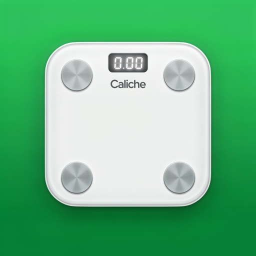

<p align="center">
  
</p>

# Caliche Balance

Web app para iPhone que toma las mediciones de tu báscula Xiaomi Mi Body Composition Scale 2 (vía Zepp Life) y las compara con rangos de referencia de Norteamérica (México, EE. UU. y Canadá), en lugar de los rangos asiáticos que usa Zepp Life.

Cada persona tiene su propia cuenta (nombre de usuario y contraseña) y sus datos se sincronizan entre dispositivos.

## Qué hace

- **Inicio:** tu última medición con peso, IMC, % de grasa y metabolismo basal. Cada valor se clasifica (Bien / Atención / Alto riesgo, siempre con ícono y texto) y muestra de dónde sale cada rango.
- **Comparación asiática:** junto al IMC te dice cómo te clasificaría un rango asiático como el de Zepp Life, para que veas la diferencia.
- **Historial:** todas las gráficas en una sola página (peso, grasa, masa libre de grasa, agua, metabolismo basal, músculo esquelético y las medidas que solo da Xiaomi), con banda saludable y línea de meta donde aplica, y la lista de mediciones.
- **Caliche Balance vs Xiaomi:** con el interruptor "Comparar con Xiaomi", las gráficas de grasa, masa libre de grasa, agua, metabolismo, masa magra, proteína y edad muestran las dos líneas (verde continua y azul punteada) y el tooltip da la diferencia. En Inicio, una tabla compara tu última pesada completa. Solo se comparan medidas que significan lo mismo: el "músculo" de Xiaomi no es músculo esquelético; se compara con la masa magra sin minerales, que es lo que sí mide.
- **Agregar a mano:** como respaldo, acepta coma decimal ("74,5").
- **Báscula Xiaomi vía Zepp Life:** trae todas tus pesadas con todos sus valores (grasa, músculo, agua, masa ósea, grasa visceral, proteína, metabolismo basal, edad corporal, puntuación, peso ideal e impedancia) y se sincroniza sola.
- **Una báscula para toda la casa:** cada persona tiene su cuenta y recibe solo sus pesadas, con invitaciones y reasignación de pesadas.
- **Puntuación Caliche (0 a 100)** al inicio, propia y transparente: combina % de grasa (50 %), IMC (30 %) e índice de músculo (20 %) con rangos publicados de Norteamérica, muestra cuánto aporta cada parte y la de Xiaomi como comparación.
- **Tú comparado con Norteamérica:** en qué percentil de IMC estás entre adultos de tu sexo y edad en EE. UU. y entre mexicoamericanos (CDC, NHANES 2015-2018).
- **Composición recalculada con ecuaciones de Norteamérica:** con la impedancia que mide la báscula se recalculan el % de grasa, la masa libre de grasa, el agua corporal, el músculo esquelético y el metabolismo basal, en lugar de usar las fórmulas de Xiaomi. También la masa magra sin minerales (comparable con el "músculo" de Xiaomi) y la proteína (experimental).
- **Cintura y riesgo visceral:** la báscula no ve la grasa del abdomen, así que puedes anotar tu cintura al agregar una medición a mano o en cualquier pesada que ya exista (Inicio o Historial). Se calcula la relación cintura entre estatura y se compara con los cortes de EE. UU./Canadá y de México.
- **Edad de tu grasa corporal:** la edad a la que un adulto típico de Norteamérica de tu sexo tiene tu % de grasa, comparando con mexicoamericanos y con estadounidenses blancos (NHANES, DXA), en lugar de la "edad corporal" de Xiaomi.
- **Notificaciones:** "Nueva pesada: 96.0 kg (−0.4 kg)" y "Tu token de Zepp caducó", en el iPhone con la app instalada (iOS 16.4+).
- **Metas de peso y de % de grasa:** barra de avance, cuánto te falta, una estimación de cuándo llegarías según tu ritmo de las últimas 4 semanas, y una línea punteada en las gráficas.
- **PWA completa:** se instala en la pantalla de inicio, abre al instante y funciona sin internet con tus pesadas de los últimos 3 meses.
- **Español e inglés**, kg o lb, modo oscuro y claro.

## Rangos de referencia

Toda la lógica está en `shared/reference.ts`:

| Medida | Fuente |
|---|---|
| IMC | Organización Mundial de la Salud (OMS): normal de 18.5 a 24.9, sobrepeso desde 25, obesidad desde 30. Es la que usan México, EE. UU. y Canadá. |
| Comparación asiática | Consulta de expertos de la OMS para poblaciones asiáticas (Lancet, 2004): sobrepeso desde 23, obesidad desde 27.5. |
| % de grasa | Gallagher y colaboradores (Am J Clin Nutr, 2000): rangos saludables por sexo y edad (20 a 39, 40 a 59, 60 a 79 años), basados en adultos blancos y afroamericanos de EE. UU. |
| Categoría de condición física | American Council on Exercise (ACE). |
| Metabolismo basal | Ecuación de Mifflin-St Jeor (1990). |

### Composición recalculada (Norteamérica)

La báscula solo mide peso e **impedancia**; todo lo demás lo calcula Zepp Life con fórmulas de Xiaomi. Caliche Balance recalcula la composición con la impedancia y ecuaciones hechas en población de EE. UU. (todo en `shared/composition.ts`):

| Medida | Ecuación | Población |
|---|---|---|
| % de grasa, masa libre de grasa, masa grasa | Sun y col., Am J Clin Nutr 2003 (ecuaciones NHANES III) | 734 hombres y 1,095 mujeres de EE. UU. (blancos y afroamericanos), 12 a 94 años |
| Agua corporal | Sun y col., 2003 | Igual |
| Músculo esquelético | Janssen y col., J Appl Physiol 2000 | 388 adultos, 18 a 86 años, medidos con resonancia magnética |
| Índice de músculo (kg/m²) y su clasificación | Janssen y col., Am J Epidemiol 2004 | NHANES III, 4,449 adultos de 60 años o más (por eso solo se clasifica desde los 60) |
| Metabolismo basal por masa magra | Katch-McArdle: 370 + 21.6 × masa libre de grasa | |
| Masa magra sin minerales | Masa libre de grasa menos minerales (6.5 % de la masa libre de grasa, Hombre de Referencia ICRP; Heymsfield y col., J Endocr Soc 2024) | |
| Proteína (experimental) | Masa libre de grasa menos agua menos minerales | Resta de dos estimaciones: el error se acumula |

Los coeficientes de Sun se verificaron contra la tabla de ecuaciones de ESPEN (Kyle y col., Clin Nutr 2004).

- **El % de grasa que usa toda la app** (clasificación, metas, gráficas) es el recalculado cuando la pesada tiene impedancia; si no la tiene (por ejemplo, una medición agregada a mano), se usa el valor de Xiaomi. Inicio dice cuál se usó y muestra el de Xiaomi como comparación.
- **Limitaciones:** estas ecuaciones se hicieron con aparatos que miden de mano a pie a 50 kHz, y la báscula Xiaomi mide de pie a pie. Los resultados son estimaciones para seguir tendencias, no un diagnóstico. La muestra de Sun no incluyó población mexicana; no hay una ecuación equivalente validada para México y Canadá juntos.
- **Por qué Xiaomi da "músculo" y aquí no:** el "músculo" de Xiaomi es masa libre de grasa menos hueso (incluye órganos, piel y agua), no músculo esquelético. Su equivalente aquí es la masa magra sin minerales; el músculo esquelético (Janssen) es otra medida, mucho menor.
- Masa ósea y grasa visceral no tienen ecuación de Norteamérica equivalente con impedancia de pie a pie; se muestran como las calcula Xiaomi. Para el riesgo visceral, usa la cintura.

### Cintura y riesgo visceral

Todo está en `shared/waist.ts`:

| Medida | Corte | Fuente |
|---|---|---|
| Cintura entre estatura | Riesgo aumentado desde 0.5, alto desde 0.6 | Ashwell y Gibson, BMJ Open 2016 |
| Cintura, EE. UU. y Canadá | Más de 102 cm (hombres) y 88 cm (mujeres) | NHLBI 1998; Health Canada 2003 |
| Cintura, México | 90 cm (hombres) y 80 cm (mujeres) | NOM-008-SSA3-2017 |

Se mide de pie, con la cinta horizontal justo arriba del hueso de la cadera, al final de una exhalación normal.

### Edad de tu grasa corporal

`shared/bodyAge.ts` usa la mediana de % de grasa por edad medida con DXA en NHANES 1999-2004 (Kelly, Wilson y Heymsfield, PLoS ONE 2009, tabla S2), para mexicoamericanos y para estadounidenses blancos. Tu edad de grasa es la edad en la que la mediana es igual a tu % de grasa (interpolando entre grupos de edad). La mediana deja de subir cerca de los 65 a 75 años; si tu % es mayor, se dice "esa edad o más". Es una aproximación: compara tu grasa estimada por impedancia con valores de DXA.

No existe una tabla oficial única para todo el continente; estas son las referencias más usadas en la región. Caliche Balance es una herramienta personal, no un dispositivo médico.

## Tecnologías

- Node.js 24 LTS (ver `.nvmrc`)
- React 19, React Router, TanStack Query y Recharts
- Tailwind CSS 4 y Vite 8
- Express 5 y el driver oficial de MongoDB
- Contraseñas con argon2; sesiones en cookie `HttpOnly`
- Vitest para las pruebas

## Correr en tu Mac

1. Usa Node 24 e instala dependencias:

```bash
cd "/Users/calicheorozco/Documents/Web Development/caliche-balance" && nvm use && npm install
```

2. Arranca la API y la web juntas:

```bash
cd "/Users/calicheorozco/Documents/Web Development/caliche-balance" && npm run dev
```

3. Abre http://localhost:5173 y crea una cuenta.

Sin configurar nada, la API usa un MongoDB local que guarda los datos en `.data/` (no se sube a git). Para usar tu MongoDB Atlas en desarrollo, copia `.env.example` a `.env.local`, llena `MONGODB_URI` y arranca con:

```bash
cd "/Users/calicheorozco/Documents/Web Development/caliche-balance" && node --env-file=.env.local scripts/dev.mjs
```

### Pruebas y revisión de tipos

```bash
cd "/Users/calicheorozco/Documents/Web Development/caliche-balance" && npm test && npm run typecheck
```

Las pruebas cubren los rangos de referencia, la conexión con Zepp (con una Zepp falsa de 3 personas: importar, invitar, unirse, privacidad, "No es mía", reasignar, token caducado, cron y borrar cuenta) y el flujo completo de la API contra un MongoDB real en memoria: registro, perfil, mediciones a mano (con coma decimal y libras), que cada persona solo vea sus datos, límite de intentos, recuperación de contraseña y borrar cuenta.

## Publicar (MongoDB Atlas + Vercel)

### 1. Base de datos en MongoDB Atlas

1. Crea una cuenta en https://www.mongodb.com/cloud/atlas y un cluster **M0 (gratis)**.
2. En **Database Access**, crea un usuario con una contraseña larga y aleatoria.
3. En **Network Access**, permite `0.0.0.0/0`. Vercel no tiene IPs fijas en el plan gratis, así que el acceso queda protegido por el usuario y la contraseña.
4. En **Connect > Drivers**, copia la cadena de conexión `mongodb+srv://...` y pon tu contraseña en ella.

Alternativa: en Vercel puedes agregar la integración de MongoDB Atlas desde el Marketplace, y crea el cluster y la variable `MONGODB_URI` por ti.

### 2. Vercel

1. Sube este proyecto a un repositorio de GitHub.
2. En https://vercel.com, **Add New > Project** e importa el repositorio. Vercel detecta Vite solo.
3. En **Environment Variables** agrega:
   - `MONGODB_URI`: la cadena de Atlas.
   - `MONGODB_DB` (opcional): `caliche-balance`.
   - `ZEPP_TOKEN_KEY`: llave para cifrar los tokens de Zepp. Genera una con `openssl rand -base64 32`. Usa la misma de tu `.env` si ya conectaste Zepp localmente contra la misma base; si la cambias, hay que volver a conectar Zepp.
   - `VAPID_PUBLIC_KEY` y `VAPID_PRIVATE_KEY`: las llaves de notificaciones (las de tu `.env`, o genera unas nuevas con `npx web-push generate-vapid-keys`). Si las cambias, cada dispositivo tiene que volver a activar las notificaciones.
   - `VAPID_SUBJECT`: la dirección `https://` de tu app en Vercel (Apple rechaza otros valores salvo `mailto:`).
   - `CRON_SECRET`: una cadena larga y aleatoria. Vercel la manda a la sincronización diaria con Zepp (`vercel.json` la programa a las 12:00 UTC).
4. Dale **Deploy**.

`vercel.json` manda todo lo que empieza con `/api` a la función `api/index.ts` (la API de Express) y el resto a la web app. Las cookies de sesión son `Secure`, así que en producción la app debe abrirse por HTTPS (Vercel ya lo da).

## Instalar en el iPhone

1. Abre la dirección de Vercel en **Safari**.
2. Toca **Compartir > Agregar a pantalla de inicio**.
3. Queda con el ícono de Caliche Balance y se abre como app, sin barra de Safari.

### Puntuación Caliche

Todo está en `shared/score.ts`:

| Parte | Peso | Referencia | 100 puntos | 50 puntos | 0 puntos |
|---|---|---|---|---|---|
| % de grasa (recalculado) | 50 % | Gallagher 2000, por sexo y edad | Dentro del rango saludable | En el límite de obesidad | 10 puntos de grasa más allá |
| IMC | 30 % | OMS | 18.5 a 24.9 | 30 (o 16 si es bajo) | 40 (o 15) |
| Índice de músculo | 20 % | Janssen 2004 (NHANES III) | Arriba del corte de riesgo moderado | En el corte de riesgo alto | 2 kg/m² debajo |

Entre esos puntos la puntuación baja en línea recta. Las referencias son publicadas; **los pesos y las pendientes son una decisión de Caliche Balance**, no un estándar clínico. Si una pesada no tiene impedancia, las partes que faltan se omiten y el resto se reparte.

### Percentiles

`shared/percentiles.ts` usa las tablas 14 y 15 de *Anthropometric Reference Data for Children and Adults: United States, 2015-2018* (CDC, Vital Health Stat 3(46), 2021, NHANES): percentiles 5 a 95 de IMC por sexo y edad, para toda la población y para mexicoamericanos. Entre percentiles publicados se interpola en línea recta; fuera del 5 al 95 se dice "menos de 5 %" o "más de 95 %". No se usan datos de Canadá porque no se encontró una tabla equivalente publicada.

## Notificaciones

- En **Ajustes > Notificaciones** se activan en cada dispositivo. En iPhone hace falta tener la app instalada en la pantalla de inicio (iOS 16.4+) y aceptar el permiso.
- **Nueva pesada:** cuando la sincronización con Zepp trae una pesada de las últimas 48 horas, con la diferencia contra la anterior, en el idioma y la unidad de cada persona. La primera importación no notifica.
- **Token de Zepp caducado:** se avisa una sola vez, a quien conectó Zepp.
- Cada tipo se puede apagar, y hay un botón para enviar una notificación de prueba. Al cerrar sesión, el dispositivo deja de recibirlas.
- Las notificaciones llegan cuando corre una sincronización: al abrir la app o con el cron diario de Vercel (una vez al día en el plan gratis). Para recibirlas más seguido sin abrir la app, un servicio externo (por ejemplo cron-job.org) puede llamar cada 15 minutos a `https://TU-APP.vercel.app/api/cron/zepp-sync` con el encabezado `Authorization: Bearer TU_CRON_SECRET`.
- Requieren las variables `VAPID_PUBLIC_KEY`, `VAPID_PRIVATE_KEY` y `VAPID_SUBJECT` (ver Vercel abajo). Sin ellas, la app funciona igual pero sin notificaciones.

## Sin conexión (PWA)

- Un service worker (generado por `vite-plugin-pwa`) guarda la app completa, así que abre al instante y sin internet. Las respuestas de `/api` nunca se guardan en el service worker.
- La app guarda en el teléfono (IndexedDB) tu perfil y tus pesadas de los **últimos 3 meses**, más tu última pesada y tu última pesada completa aunque sean más viejas. Sin internet ves esos datos con un aviso de "Sin conexión". Lo guardado caduca a los 90 días sin abrir la app con internet.
- Al cerrar sesión o borrar la cuenta, se borra lo guardado en el teléfono.
- Sin internet no se puede agregar ni sincronizar; la app lo indica.
- El service worker solo existe en la versión compilada. Para probarlo en tu Mac:

```bash
cd "/Users/calicheorozco/Documents/Web Development/caliche-balance" && npm run build && npx vite preview --port 4173
```

(con la API corriendo en otra terminal con `node --env-file=.env scripts/dev.mjs`). Safari en iPhone necesita HTTPS para el service worker, así que en el iPhone funciona una vez publicada en Vercel.

## Conectar la báscula Xiaomi (Zepp Life)

Caliche Balance lee tus pesadas de la nube de Zepp, la misma que usa la app Zepp Life. **Es una conexión no oficial** (descubierta por el proyecto [zepp-life-mcp](https://github.com/kubulashvili/zepp-life-mcp)): Zepp puede cambiarla o bloquearla sin aviso.

### Quien tiene la báscula ligada a su Zepp Life

1. En una computadora, entra a `https://user.huami.com/privacy2/index.html` e inicia sesión con tu cuenta de Zepp Life.
2. Abre las herramientas de desarrollador (en Chrome: ⌥⌘I), ve a **Application > Cookies** y copia los valores de `apptoken` y `userid`.
3. En Caliche Balance, ve a **Ajustes > Báscula Xiaomi (Zepp Life)**, pégalos y toca **Conectar**. Se importa todo tu historial.

El token da acceso a tu cuenta de Zepp: se guarda cifrado (AES-256-GCM) y la llave solo vive en el servidor. Si caduca, la app lo indica y pegas uno nuevo en el mismo lugar.

### Para los demás de la casa

1. En **Zepp Life**, agrega a cada persona como **miembro de la familia** (nombre, sexo, fecha de nacimiento y estatura). Zepp asigna cada pesada a la persona con el peso más parecido.
2. En Caliche Balance, cada persona crea su propia cuenta.
3. Quien conectó Zepp toca **Invitar** junto a cada persona en **Ajustes** y le comparte el código (sirve una vez y vence en 7 días).
4. La otra persona lo escribe en **Ajustes > Unirme a la báscula de mi casa**. Sus pesadas anteriores y futuras llegan a su cuenta.

Cada quien solo ve sus propias pesadas. Quien conectó Zepp ve la lista de personas y las pesadas sin asignar, pero no las pesadas de los demás dentro de Caliche Balance.

Si Zepp asigna una pesada a la persona equivocada (pasa cuando dos personas pesan parecido), la persona toca **No es mía** en su historial y quien conectó Zepp la reasigna desde **Ajustes > Pesadas sin asignar**.

### Sincronización

- Cada vez que abres la app, vuelves a ella desde otra app o recuperas internet (el servidor hace una sincronización real como máximo cada 2 minutos).
- Con **Sincronizar ahora** en Ajustes.
- Una vez al día con Vercel Cron.

Las pesadas no se duplican.

## Cuentas y seguridad

- Registro abierto con nombre de usuario y contraseña (mínimo 8 caracteres). No se pide correo.
- Si el inicio de sesión falla, la app dice exactamente por qué: el usuario no existe, la contraseña no es correcta (y cuántos intentos quedan) o hay que esperar N minutos. Como el registro ya revela qué usuarios existen, decirlo no reduce la seguridad.
- Al registrarte recibes un **código de recuperación**. Es la única forma de recuperar la cuenta si olvidas la contraseña. Al usarlo, se genera uno nuevo y se cierran las demás sesiones.
- Límite de intentos: 10 registros por hora por IP, 10 inicios de sesión **fallidos** cada 15 minutos por usuario e IP (los exitosos no cuentan) y 5 recuperaciones por hora.
- Cada persona solo ve y borra sus propios datos. En **Ajustes > Borrar mi cuenta** se eliminan la cuenta, las mediciones y las sesiones. Si esa persona conectó Zepp, también se eliminan la conexión y las pesadas sin asignar.

## Estructura

| Carpeta | Qué contiene |
|---|---|
| `shared/` | Rangos de referencia (`reference.ts`), composición recalculada (`composition.ts`), Puntuación Caliche (`score.ts`), percentiles de los CDC (`percentiles.ts`), avance de metas (`goals.ts`) y validación de datos (`schemas.ts`), compartidos por la web y la API |
| `server/` | API de Express, conexión a MongoDB y sesiones; `zepp.ts` (cliente de Zepp y cifrado), `zeppSync.ts` (importación) y `zeppRoutes.ts` (conexión, casa e invitaciones) |
| `api/index.ts` | Punto de entrada de la API en Vercel |
| `src/` | Web app de React (pantallas en `src/pages/`, textos en español e inglés en `src/i18n.tsx`, datos sin conexión en `src/offline.ts`) |
| `public/` | Íconos (el manifiesto y el service worker se configuran en `vite.config.ts`) |
| `assets/icon-source.png` | Logo original en 1024×1024, del que salen todos los íconos |
| `scripts/` | Arranque local (`dev.mjs`) y generador de íconos (`make-icons.sh`) |
| `tests/` | Pruebas de los rangos y de la API |

## Cambiar el logo

El logo vive en `assets/icon-source.png` (cuadrado, mínimo 1024×1024, con el fondo verde hasta las orillas y sin esquinas redondeadas; el iPhone las redondea solo). Si lo reemplazas, genera de nuevo los íconos de `public/`:

```bash
cd "/Users/calicheorozco/Documents/Web Development/caliche-balance" && ./scripts/make-icons.sh
```

Hecho con 💚 por Caliche.
